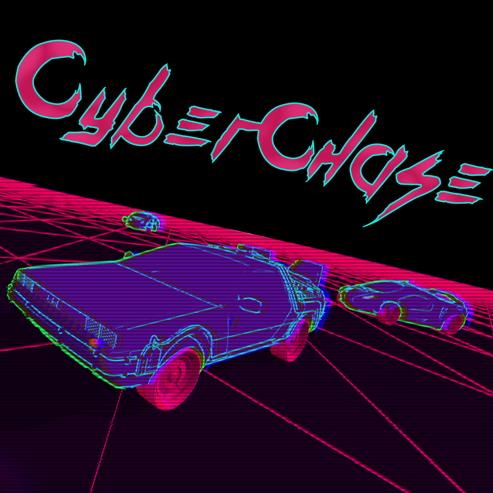
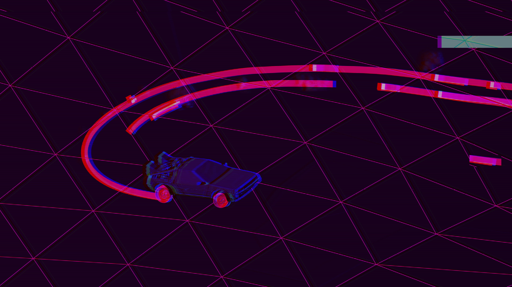

  

<b>Outrun the police through neon-lit streets.</b> 
A retrofuturistic arcade chase game built in Unity, my first solo project from 2018.

  
  
  
  

  <a href="README.pl.md">Polski</a> · <b>English</b> ·
  <a href="#quick-start">Quick start</a> · <a href="#screenshots">Screenshots</a> ·
  <a href="#about-this-archive">About this archive</a> · <a href="#credits-and-licences">Credits</a>

Cyber-Chase is set in a retrofuturistic world inspired by synthwave, vaporwave and 80s VHS aesthetics. It is a simple arcade-style game in which the player must outrun the police through neon-lit streets. It was created in 2018 as a personal learning challenge, built from a mix of tutorials and study materials.

## Quick start

There is no release or ready-made build yet, so the game currently runs from source in the Unity editor.

1. Clone this repository and open its root folder as a project in Unity. The editor version is listed in [`ProjectSettings/ProjectVersion.txt`](ProjectSettings/ProjectVersion.txt).
2. Open the scene [`Assets/Scenes/Menu.unity`](Assets/Scenes/Menu.unity) and press Play.

## Screenshots

## About this archive

The purpose of this repository is to preserve the first functional game I ever made and keep it playable on modern versions of Unity. The original gameplay and visual identity remain intact, while selected legacy systems have been modernized and small quality-of-life and reliability improvements have been introduced.

- **Preserving history** — the project stays a milestone of my early development journey.
- **Working on modern Unity** — the game is kept functional on current editor versions.
- **Retro style** — the original synthwave atmosphere and visual style are maintained.
- **Careful modernization** — legacy systems are updated and gameplay improved without changing the character of the original project.

## Credits and licences

Created by Daniel Pytel (2018); modernization and maintenance by the same author.

The project contains modified portions of KinoGlitch by Keijiro Takahashi (MIT licence), used for the glitch effects. The full notice and licence text are in [`THIRD_PARTY_NOTICES.md`](THIRD_PARTY_NOTICES.md).
