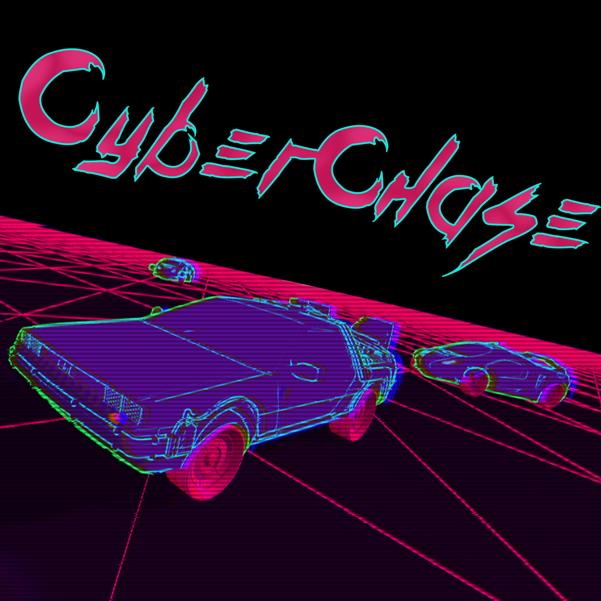
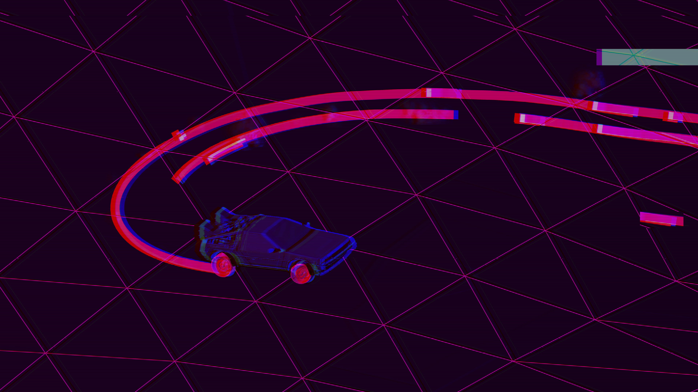

  

<b>Uciekaj policji po neonowych ulicach.</b> 
Retrofuturystyczna arcade'owa gra pościgowa w Unity, mój pierwszy samodzielny projekt z 2018 roku.

  
  
  
  

  <b>Polski</b> · <a href="README.md">English</a> ·
  <a href="#szybki-start">Szybki start</a> · <a href="#zrzuty-ekranu">Zrzuty ekranu</a> ·
  <a href="#o-archiwum">O archiwum</a> · <a href="#autorstwo-i-licencje">Autorstwo</a>

Akcja Cyber-Chase toczy się w retrofuturystycznym świecie inspirowanym synthwave, vaporwave i estetyką VHS z lat 80. To prosta gra w stylu arcade, w której trzeba uciec policji po neonowych ulicach. Powstała w 2018 roku jako osobiste wyzwanie edukacyjne, na podstawie tutoriali i materiałów do nauki.

## Szybki start

Nie ma jeszcze wydania ani gotowej paczki, więc gra uruchamia się obecnie ze źródeł w edytorze Unity.

1. Sklonuj to repozytorium i otwórz jego główny folder jako projekt w Unity. Wersja edytora jest podana w [`ProjectSettings/ProjectVersion.txt`](ProjectSettings/ProjectVersion.txt).
2. Otwórz scenę [`Assets/Scenes/Menu.unity`](Assets/Scenes/Menu.unity) i uruchom grę przyciskiem Play.

## Zrzuty ekranu

## O archiwum

To repozytorium ma zachować pierwszą działającą grę, jaką stworzyłem, i utrzymać ją grywalną w nowych wersjach Unity. Oryginalna rozgrywka i styl wizualny pozostają bez zmian, a wybrane przestarzałe systemy zostały zmodernizowane i uzupełnione drobnymi usprawnieniami wygody oraz niezawodności.

- **Zachowanie historii** — projekt pozostaje kamieniem milowym moich początków w tworzeniu gier.
- **Działanie w nowym Unity** — gra jest utrzymywana jako działająca w aktualnych wersjach edytora.
- **Retro styl** — zachowana jest oryginalna atmosfera synthwave i styl wizualny.
- **Ostrożna modernizacja** — stare systemy są aktualizowane, a rozgrywka poprawiana bez zmiany charakteru oryginału.

## Autorstwo i licencje

Autor: Daniel Pytel (2018); modernizacja i utrzymanie przez tego samego autora.

Projekt zawiera zmodyfikowane fragmenty KinoGlitch autorstwa Keijiro Takahashi (licencja MIT), użyte do efektów zakłóceń obrazu. Pełna informacja i tekst licencji znajdują się w [`THIRD_PARTY_NOTICES.md`](THIRD_PARTY_NOTICES.md).
